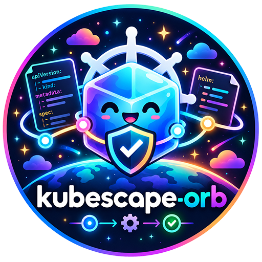
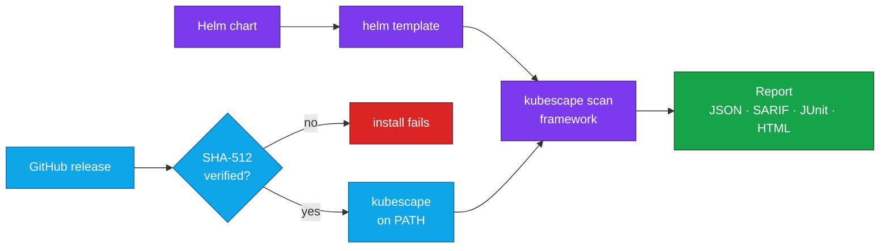

<div align="center">



# Kubescape Orb for CircleCI

### Catch Kubernetes misconfigurations in CI, long before they reach a cluster.

Install [Kubescape](https://kubescape.io) and scan your Helm charts against **NSA-CISA**, **MITRE**, **CIS**, **SOC 2** and more<br>
with two steps of CircleCI config.<br>
Strict SHA-512 verification by default · No `sudo` · No usage data collected by the orb

[](https://circleci.com/gh/juburr/kubescape-orb)
[](https://circleci.com/developer/orbs/orb/juburr/kubescape-orb)
[](LICENSE)
[](https://discuss.circleci.com/c/ecosystem/orbs)


**[Quick Start](#-quick-start)** · **[Features](#-why-kubescape-orb)** · **[Frameworks](#-frameworks)** · **[Commands](#-commands)** · **[Security](#-secure-by-design)** · **[Offline Scans](#-running-offline)**

<sub>An unofficial, community-maintained orb. [Contributions are welcome!](#-contributing)</sub>

</div>

<br>

## ✨ Why kubescape-orb?

<table>
<tr>
<td width="33%" valign="top">
🎯 <b>Compliance frameworks, built in</b><br><br>
NSA-CISA, MITRE, SOC 2, CIS benchmarks for EKS, AKS, GKE and upstream Kubernetes, and more. Or scan with <code>all</code> of them.
</td>
<td width="33%" valign="top">
⚓ <b>Helm-native</b><br><br>
Hand it a chart directory, a packaged <code>.tgz</code>, a <code>repo/chart</code> reference or an <code>oci://</code> URL. The orb renders it with <code>helm template</code> and scans every resource it produces.
</td>
<td width="33%" valign="top">
📊 <b>Reports your tooling speaks</b><br><br>
JSON, JUnit, SARIF, HTML, PDF and Prometheus, plus CSV, Markdown, GitLab SAST and more on Kubescape 4.x.
</td>
</tr>
<tr>
<td width="33%" valign="top">
🔐 <b>Verified installs, fail-closed by default</b><br><br>
By default, every Kubescape binary is checked against a SHA-512 table built into the orb, and versions it can't verify are refused, not run. <a href="#-checksum-verification">Opt-outs</a> are explicit.
</td>
<td width="33%" valign="top">
🦾 <b>amd64 and arm64</b><br><br>
Picks the right Kubescape build for x86_64 executors and CircleCI Arm resource classes, cached per version and architecture.
</td>
<td width="33%" valign="top">
📡 <b>Air-gap friendly</b><br><br>
Point <code>artifacts_dir</code> at pre-downloaded policies and scans of a local chart need no network access at all.
</td>
</tr>
</table>

### 🧩 The Orb vs. a Hand-Rolled Script

| | Scripting Kubescape yourself | With the orb |
| --- | --- | --- |
| **Installing Kubescape** | Download a release from GitHub, then find and check its checksum yourself | `kubescape/install` checks a SHA-512 from a built-in table for amd64 and arm64, fails closed on unknown versions, and caches the release |
| **Scanning a chart** | Render it with `helm template`, scan the output, and delete the rendered manifests, which can hold Secret values, even when the scan fails | `scan_helm_chart` renders into a private temporary directory that is removed when the step ends, pass or fail |
| **Verbose reports on Kubescape 4.x** | `kubescape scan --verbose` panics while printing results when stdin is a terminal, as it is in CircleCI steps | `scan_helm_chart` runs Kubescape with stdin redirected from `/dev/null` |
| **Scanning offline** | Pass `--use-artifacts-from`, and set `KS_SKIP_UPDATE_CHECK` so the update check doesn't stall the scan where egress is silently dropped | `artifacts_dir` does both |

## 🔄 How It Works



`kubescape/install` downloads Kubescape straight from its official GitHub releases, verifies its SHA-512 checksum in the default `strict` mode shown here, and puts it on `PATH`. See [Checksum Verification](#-checksum-verification) for the other modes. `kubescape/scan_helm_chart` renders your chart and scans it with the framework you choose.

## 🚀 Quick Start

Add the orb, install Kubescape, scan your chart. Copy this into `.circleci/config.yml`:

```yaml
version: 2.1

orbs:
  kubescape: juburr/kubescape-orb@latest

jobs:
  helm_scan:
    docker:
      # scan_helm_chart needs Helm on PATH; cimg/deploy includes it, cimg/base does not.
      - image: cimg/deploy:2026.10
    steps:
      - checkout
      - run: helm package charts/myservice --destination /home/circleci/helm_charts
      - kubescape/install:
          version: "4.0.15"
      - kubescape/scan_helm_chart:
          chart: /home/circleci/helm_charts/myservice-1.0.0.tgz
          framework: nsa
          output_file: myservice_nsa_scan.json
          output_format: json
      - store_artifacts:
          path: myservice_nsa_scan.json

workflows:
  security_scan:
    jobs:
      - helm_scan
```

Swap in your chart, push, and the report shows up under the job's **Artifacts** tab. `chart` takes anything `helm template` does: a chart directory, a packaged `.tgz`, a `repo/chart` reference or an `oci://` URL. Building the chart in an earlier job instead? Save it with `persist_to_workspace` and `attach_workspace` before the scan, as the [offline example](#-running-offline) does.

> [!TIP]
> Upgrading from `helm_scan_framework`? The next release renames it and three of its parameters. See [Upgrading](#-upgrading).

> [!TIP]
> This example uses the NSA framework for demonstration purposes, but many organizations will elect to use `all` (the default, if `framework` isn't supplied).

> [!NOTE]
> Scans report findings without failing the job: Kubescape exits 0 when controls fail, since this orb doesn't pass a compliance or severity threshold. It exits non-zero on errors, such as an unknown framework, a failed policy download, or a chart with no resources the framework covers.

## 🧭 Frameworks

Set `framework` on `scan_helm_chart` to any of these. Names match `kubescape list frameworks`, which also prints each framework's description.

| `framework` | What it checks |
| --- | --- |
| `all` *(default)* | Every framework at once |
| `allcontrols` | Every control in Kubescape's library |
| `nsa` | NSA-CISA Kubernetes Hardening Guidance |
| `mitre` | MITRE ATT&CK-based threat matrix for Kubernetes |
| `soc2` | SOC 2 |
| `security` | Kubescape's security-focused controls |
| `armobest` | ARMO's recommended best practices |
| `devopsbest` | DevOps best practices |
| `cis-v1.10.0`<br>`cis-v1.12.0` | CIS Kubernetes Benchmark |
| `cis-eks-t1.7.0`<br>`cis-eks-t1.8.0` | CIS Amazon EKS Benchmark |
| `cis-aks-t1.2.0`<br>`cis-aks-t1.8.0` | CIS Azure AKS Benchmark |
| `cis-gke-v1.9.0` | CIS Google GKE Benchmark |
| `agentruntimehardening` | Agent Sandbox resources (`Sandbox`, `SandboxTemplate`, `WorkerPool`) only. Charts without them fail with "no resources found to scan". |

## 📊 Output Formats

Give `output_file` the extension that matches `output_format` so the report lands at exactly that path on either Kubescape version (see [Kubescape Versions](#-kubescape-versions)).

| `output_format` | Extension | Kubescape 3.x | Kubescape 4.x |
| --- | --- | :---: | :---: |
| `json` *(default)* | `.json` | ✅ | ✅ |
| `junit` | `.xml` | ✅ | ✅ |
| `sarif` | `.sarif` | ⚠️ no results for charts | ✅ |
| `html` | `.html` | ✅ | ✅ |
| `pdf` | `.pdf` | ✅ | ✅ |
| `pretty-printer` | `.txt` | ✅ | ✅ |
| `prometheus` | `.txt` | ✅ | ✅ |
| `csv` | `.csv` | ➖ | ✅ |
| `markdown` | `.md` | ➖ | ✅ |
| `yaml` | `.yaml` | ➖ | ✅ |
| `policyreport` | `.yaml` | ➖ | ✅ |
| `gitlab-sast` | `.json` | ➖ | ✅ |
| `github-actions` | `.txt` | ➖ | ✅ |
| `exceptions` | `.exceptions.json` | ➖ | ✅ |

➖ Kubescape 3.x silently writes pretty-printer output for these formats.

## 🔢 Kubescape Versions

v0.4.0 of this orb changed the default Kubescape `version` from 3.0.38 to 4.0.15, a new major version. Pin `version` on the `install` command, as in the [Quick Start](#-quick-start), so Kubescape only changes when you decide to rather than whenever the orb is upgraded.

CI runs `scan_helm_chart` with Kubescape 3.0.38 and 4.0.15 on amd64, and installs and scans with both on arm64. Both versions accept the same flags and framework names. Both exit 0 when controls fail, since this orb doesn't pass a compliance or severity threshold, and exit non-zero on errors: an unknown framework, a failed policy download, or a chart with no resources the framework covers. Differences that matter when moving from 3.x to 4.x:

| | Kubescape 3.x | Kubescape 4.x |
| --- | --- | --- |
| `output_format` | `pretty-printer`, `json`, `junit`, `prometheus`, `pdf`, `html`, `sarif`. Other values silently produce pretty-printer output. | Every format the orb accepts, adding `csv`, `markdown`, `yaml`, `gitlab-sast`, `github-actions`, `policyreport` and `exceptions`. |
| SARIF output | Valid, but contains no results for scanned charts | Includes results |
| `output_file` extension | Appended when missing for `json`, `junit` (`.xml`), `sarif`, `html` and `pdf` | Appended when missing for every format, e.g. `.txt` for `pretty-printer` and `prometheus` |
| JSON report | Baseline | Same `summaryDetails` structure; adds `namespaceSummaries`, drops `jobID`, `paginationInfo` and `customerGUIDGenerated` |
| `--verbose` with a terminal on stdin (as in CircleCI steps) | Works | Panics while printing results (exit 2). `scan_helm_chart` runs Kubescape with stdin redirected from `/dev/null`, so it is unaffected; do the same if you run `kubescape scan --verbose` in your own steps. |
| Network access during scans | GitHub, to download policies | GitHub, plus `tuf-repo-cdn.sigstore.dev`: 4.x verifies downloaded policies with Sigstore and fails the scan if it can't |

Give `output_file` the extension that matches `output_format` (see [Output Formats](#-output-formats)) so the report lands at exactly that path on either version. The `cis-eks-t1.2.0` and `cis-v1.23-t1.0.1` frameworks have been removed from Kubescape's policy library and fail on every Kubescape version, so `scan_helm_chart` no longer accepts them.

## 🧰 Commands

### `kubescape/install`

Installs Kubescape for Linux on amd64 or arm64, matching the executor's CPU. In the default `strict` mode it verifies the SHA-512 checksum first and refuses versions it has no checksum for; see [Checksum Verification](#-checksum-verification) for the opt-outs. Run it before the orb's other commands. Needs bash 4 or newer on the executor.

| Parameter | Default | Description |
| --- | --- | --- |
| `version` | `4.0.15` | Kubescape release to install; a leading `v` is ignored. Pin it so Kubescape only changes when you decide to. Values that aren't a release version, such as `latest`, are rejected. |
| `install_path` | `$HOME/bin` | Absolute path of the directory to install into, writable without root. Created if needed, and added to `PATH` for later steps when it isn't already on it. A leading `~/` is expanded. |
| `verify_checksums` | `strict` | `strict`, `known_versions` or `false`. See [Checksum Verification](#-checksum-verification). |
| `caching` | `true` | Cache the verified release between jobs, keyed by version, CPU architecture and home directory. A cached release is verified again before it is installed. |

### `kubescape/scan_helm_chart`

Renders a Helm chart with `helm template` and scans the resulting Kubernetes resources against one Kubescape framework's security controls. Needs Helm on the executor's `PATH`.

| Parameter | Default | Description |
| --- | --- | --- |
| `chart` | *required* | Chart to scan: anything `helm template` accepts, such as a chart directory, a packaged `.tgz` file, a `repo/chart` reference, or an `oci://` URL. |
| `output_file` | *required* | Path of the report file. Use the extension that matches `output_format`. |
| `framework` | `all` | The one framework to scan with. See [Frameworks](#-frameworks). |
| `output_format` | `json` | Report format, Kubescape's `--format`. See [Output Formats](#-output-formats). |
| `release_namespace` | `kubescape-orb` | Namespace passed to `helm template`, which only sets `.Release.Namespace` while rendering. Nothing is deployed. |
| `verbose` | `true` | Include passed resources and controls in the report, not only failed ones (Kubescape's `--verbose`, which is off by default in Kubescape itself). It doesn't change the log level. |
| `artifacts_dir` | *(empty)* | Directory created with `kubescape download artifacts --output <dir>`, to scan without downloading policies. See [Running Offline](#-running-offline). |

Environment variables are expanded in `install`'s `version` and `install_path`, and in `scan_helm_chart`'s `chart`, `output_file`, `release_namespace` and `artifacts_dir`.

## 📦 Upgrading

The next release renames the scan command and three of its parameters. Update your config as follows:

| Old | New |
| --- | --- |
| `helm_scan_framework` command | `scan_helm_chart` command |
| `helm_scan_framework.chart_path` | `scan_helm_chart.chart` |
| `helm_scan_framework.namespace` | `scan_helm_chart.release_namespace` |
| `helm_scan_framework.artifacts_path` | `scan_helm_chart.artifacts_dir` |

`framework`, `output_file`, `output_format` and `verbose` keep their names and behavior.

Behavior changes:
- `scan_helm_chart` renders the chart into a private temporary directory, removed when the step ends even if the scan fails, instead of `~/.local/share/kubescape-orb/yamls/chart.yaml`, which a failed scan left behind. Reports name the rendered file by its new path.
- Error and warning messages go to stderr.

## 🔒 Secure by Design

- **Least Privilege**: Installs to a user-owned directory by default, with no `sudo` usage anywhere in this orb.
- **Integrity**: SHA-512 checksum validation of downloaded binaries, on by default and failing closed: a Kubescape version this orb has no checksum for is refused, not installed unverified, and a binary that can't run on the executor never replaces an existing install. See [Checksum Verification](#-checksum-verification) for the `known_versions` and `false` opt-outs.
- **Provenance**: Installs directly from Kubescape's official [releases page](https://github.com/kubescape/kubescape/releases/) on GitHub. No third-party websites, domains, or proxies are used.
- **Confidentiality**: All secrets and environment variables are handled in accordance with CircleCI's [security recommendations](https://circleci.com/docs/security-recommendations/) and [best practices](https://circleci.com/docs/orbs-best-practices/).
- **Privacy**: No usage data of any kind is collected or shipped back to the orb developer. Kubescape itself is a separate matter: its update check sends details such as its version, the framework being scanned and the scan context to `version-check.ks-services.co` unless `KS_SKIP_UPDATE_CHECK` is `"true"` or `artifacts_dir` is set, and Kubescape 4.x exports OpenTelemetry traces and metrics when the job sets `OTEL_EXPORTER_OTLP_ENDPOINT`. See [Network Access](#-network-access).

> [!IMPORTANT]
> **Info for security teams:** see [Network Access](#-network-access) for the hosts to allow on locked-down or self-hosted runners, and [Running Offline](#-running-offline) for scanning without network access.

## 💻 Supported Platforms

Linux executors on `x86_64` (amd64) and `aarch64`/`arm64` (arm64), including CircleCI [Arm resource classes](https://circleci.com/docs/using-arm/). The `install` command picks the Kubescape release asset for the architecture reported by `uname -m` and, in the default `strict` mode, verifies it against that architecture's SHA-512 checksum. Any other operating system or architecture fails the install rather than installing a binary that can't run.

`install` needs bash 4 or newer, `mktemp`, and `curl` or `wget`, plus `sha512sum` when it verifies. CircleCI's `cimg` and machine images have all of them.

The download cache is keyed by Kubescape version, executor architecture and home directory, so amd64 and arm64 jobs never share a cached binary. On executors whose `PATH` doesn't already include `install_path` (for example, machine executors), `install` adds it for later steps through `BASH_ENV`.

## 🔐 Checksum Verification

The `install` command checks the downloaded Kubescape binary against a SHA-512 lookup table built into the orb, with one entry per Kubescape version and architecture. The `verify_checksums` parameter controls what happens:

| Value | Version in the orb's table | Version not in the table |
| --- | --- | --- |
| `strict` (default) | ✅ Verified; install fails on mismatch | ⛔ Install fails before anything is downloaded |
| `known_versions` | ✅ Verified; install fails on mismatch | ⚠️ Installed **unverified**, with a warning |
| `false` | ⚠️ Not verified | ⚠️ Installed **unverified** |

The table covers every Kubescape release this orb version knows about, including the default `version`. If you pin a Kubescape release newer than this orb, `strict` fails until the orb is upgraded. Upgrade the orb (or open a PR adding the checksum, generated with `src/scripts/install_hash.sh`) rather than opting out. `known_versions` and `false` remain available for cases where you accept running an unverified binary.

> [!WARNING]
> **Changed in v0.5.0:** the default was previously `known_versions`, which installed unlisted versions without verification. Pipelines that pin a Kubescape version newer than the orb's table now fail until they upgrade the orb or set `verify_checksums: known_versions` explicitly.

## 🌐 Network Access

Hosts to allow (HTTPS, port 443) when running on a locked-down or self-hosted runner. They were confirmed by recording every connection Kubescape 3.0.38 and 4.0.15 made during `install` and `scan_helm_chart`.

| Host | Needed by | Purpose |
| --- | --- | --- |
| `github.com` | `install`, `scan_helm_chart` | Kubescape release download; at scan time, policy downloads from [kubescape/regolibrary](https://github.com/kubescape/regolibrary/releases) releases |
| `release-assets.githubusercontent.com` | `install`, `scan_helm_chart` | Where GitHub redirects release downloads |
| `objects.githubusercontent.com` | `install`, `scan_helm_chart` | GitHub's previous redirect target for release downloads; allow it as well so a change on GitHub's side doesn't break downloads |
| `tuf-repo-cdn.sigstore.dev` | `scan_helm_chart` with Kubescape 4.x | Sigstore trust root used to verify the downloaded policies' signatures. **Required:** when it is blocked, 4.x scans fail with `checksum verification failed ... failed to fetch Sigstore trusted root` |

Optional hosts. Kubescape carries on without them:

| Host | Used for | Notes |
| --- | --- | --- |
| `version-check.ks-services.co` | Kubescape's update check, on every scan | Set `KS_SKIP_UPDATE_CHECK: "true"` in the job's `environment` to turn it off. Where egress is silently dropped rather than rejected, it adds about a minute to each scan. |
| Registries of the chart's container images (e.g. `index.docker.io`, `auth.docker.io`) | Image signature controls in the `all`, `allcontrols` and `armobest` frameworks | Other frameworks don't contact registries |

`scan_helm_chart` renders the chart with `helm template`, which needs no network access for a chart directory or `.tgz` file. A `repo/chart` or `oci://` chart is downloaded from its chart repository or registry, so allow that host too. The orb doesn't install Helm, so `get.helm.sh` isn't needed unless you install Helm yourself.

## 📡 Running Offline

`scan_helm_chart` only needs the network to download Kubescape's policies (frameworks, control inputs, exceptions and attack tracks), and the chart itself when it comes from a chart repository or registry. To scan a local chart without network access, download the policies where access is available and pass the directory as `artifacts_dir`:

```yaml
jobs:
  package_chart:
    docker:
      - image: cimg/deploy:2026.10
    steps:
      - checkout
      - run: helm package charts/myservice --destination /home/circleci/helm_charts
      - persist_to_workspace:
          root: /home/circleci
          paths:
            - helm_charts

  download_kubescape_artifacts:
    docker:
      - image: cimg/base:current-22.04
    steps:
      - kubescape/install:
          version: "4.0.15"
      # Kubescape 4.x verifies the policies' Sigstore signatures here.
      - run: kubescape download artifacts --output /home/circleci/kubescape-artifacts
      - persist_to_workspace:
          root: /home/circleci
          paths:
            - kubescape-artifacts

  helm_scan_offline:
    docker:
      - image: cimg/deploy:2026.10
    steps:
      - attach_workspace:
          at: /home/circleci
      # Downloads from GitHub; see below for runners with no route to it.
      - kubescape/install:
          version: "4.0.15"
      - kubescape/scan_helm_chart:
          artifacts_dir: /home/circleci/kubescape-artifacts
          chart: /home/circleci/helm_charts/myservice-1.0.0.tgz
          framework: nsa
          output_file: myservice_nsa_scan.json
          output_format: json

workflows:
  scan:
    jobs:
      - package_chart
      - download_kubescape_artifacts
      # The scan job only sees workspace files (the chart and the
      # artifacts) from the jobs it requires.
      - helm_scan_offline:
          requires:
            - package_chart
            - download_kubescape_artifacts
```

With `artifacts_dir` set, Kubescape loads the policies from that directory and skips its update check, so scanning a chart directory or `.tgz` file opens no network connections. The exception is `all`, `allcontrols` and `armobest`, whose image signature controls still try to reach container registries and carry on when they can't. Download the artifacts with the same Kubescape version that scans, and refresh them regularly, since stale artifacts mean stale controls. You can also commit the directory to your repository instead of using a workspace.

`install` itself downloads Kubescape from GitHub. On a runner with no route to GitHub at all, bake Kubescape into the executor image instead, after checking its SHA-512 against the table in [`src/scripts/install.sh`](src/scripts/install.sh), and skip `install`.

## 🤝 Contributing

This is an unofficial, community-maintained orb, and contributions are welcome! Bug reports, feature ideas and pull requests all help.

- **Found a bug or have an idea?** [Open an issue](https://github.com/juburr/kubescape-orb/issues).
- **Need a newer Kubescape release?** Generate its checksums with `src/scripts/install_hash.sh -v <version>`, paste them into the `sha512sums` table in [`src/scripts/install.sh`](src/scripts/install.sh), and open a pull request. The script checks each asset against the checksums Kubescape publishes, and needs `cosign` for releases from 4.0.13 on, whose checksum lists are signed.
- **Before opening a pull request**, run the checks CI runs. The tests run offline, with stand-ins for `helm` and `kubescape` where they need them.

  ```bash
  yamllint .
  shellcheck src/scripts/*.sh tests/*.sh
  for t in tests/*_test.sh; do bash "$t" || break; done
  circleci orb pack src > orb.yml && circleci orb validate orb.yml
  ```

## 🎨 Logo

Need the logo for a slide deck, blog post, or internal developer portal? PNGs with transparent backgrounds are in [`assets/logos`](assets/logos): [64](assets/logos/kubescape-orb-64px.png) · [128](assets/logos/kubescape-orb-128px.png) · [256](assets/logos/kubescape-orb-256px.png) · [512](assets/logos/kubescape-orb-512px.png) · [1024](assets/logos/kubescape-orb-1024px.png) px

## 📜 License

[MIT](LICENSE) © 2024-2025 Justin Burr

<br>

<div align="center">
  
  <br>
  <sub>Find it in CI, not in production. If this orb helps your team, a ⭐ helps others find it.</sub>
  <br>
  <sub><a href="#kubescape-orb-for-circleci">Back to top ↑</a></sub>
</div>
